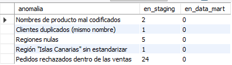
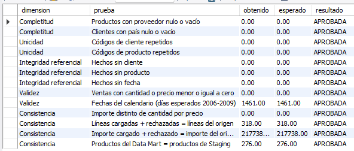

# Pruebas de calidad de datos

Pruebas que evalúan la calidad de los datos del proceso ETL de Jardinería
(origen → Staging → Data Mart).

## Scripts

| Script | Qué hace |
|---|---|
| `anomalias_y_correcciones.sql` | Compara cada anomalía encontrada en Staging con su estado en el Data Mart |
| `pruebas_contenido_esperado.sql` | Doce pruebas que comparan lo obtenido con lo esperado |

## Anomalías detectadas y corregidas

| Anomalía | En Staging | En el Data Mart | Corrección aplicada |
|---|---|---|---|
| Nombres de producto mal codificados | 2 | 0 | REPLACE en la vista de productos |
| Clientes duplicados (mismo nombre) | 1 | 0 | Se conserva el menor ID por nombre |
| Regiones nulas | 5 | 0 | COALESCE con "Sin región" |
| Región "Islas Canarias" sin estandarizar | 1 | 0 | Catálogo de región con LEFT JOIN |
| Pedidos rechazados dentro de las ventas | 24 | 0 | Cuarentena y filtro en la vista de ventas |

## Pruebas de contenido esperado

Doce pruebas agrupadas por dimensión de calidad. Todas resultaron APROBADAS.

| Dimensión | Qué se comprueba |
|---|---|
| Completitud | Proveedor y país sin valores nulos ni vacíos |
| Unicidad | Códigos de cliente y de producto sin repetir |
| Integridad referencial | Hechos sin cliente, producto o fecha (0) |
| Validez | Cantidades y precios positivos; 1.461 días de calendario |
| Consistencia | Importe = cantidad × precio; líneas e importe cargados + rechazados = origen; productos del Data Mart = Staging |

## Cómo ejecutarlo

Ejecutar los scripts en MySQL con las bases `jardineria`,
`jardineria_staging` y `dm_jardineria` ya cargadas.